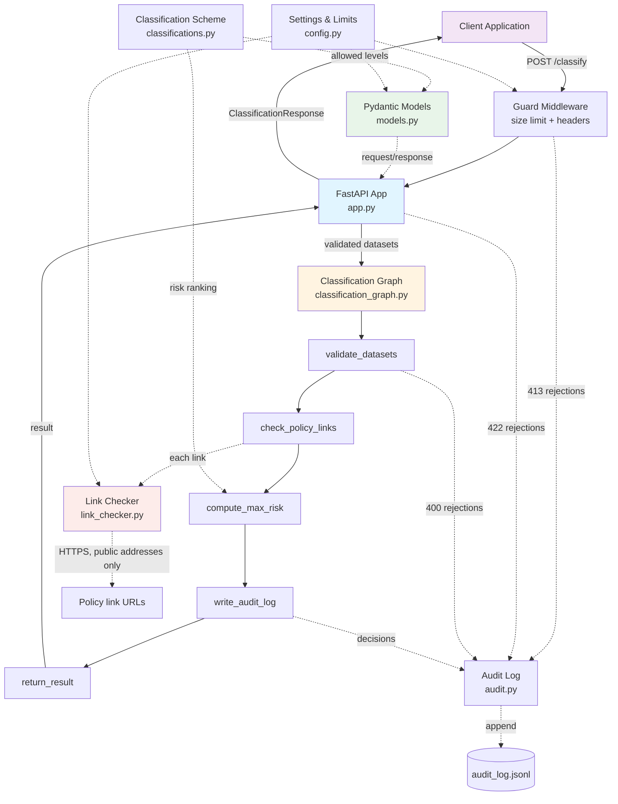
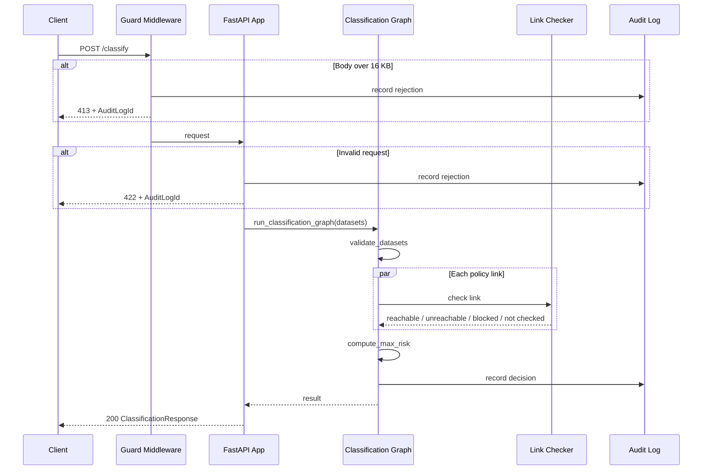

# PolicyChecker Architecture & Data Flow

## System Architecture Diagram

## Data Flow Diagram

## Component Breakdown

### 1. Guard Middleware (`app.py`)
- Caps the request body at 16 KB, including requests sent without a declared length, and audits oversized requests (`413`)
- Adds `X-Content-Type-Options: nosniff` and `Cache-Control: no-store` to every response

### 2. FastAPI Application (`app.py`)
- **Purpose**: HTTP API layer
- Receives `POST /classify`, validates input with the Pydantic models
- Audits invalid requests and returns `422` with an audit ID
- Converts pipeline rejections to `400` (with audit ID) and unexpected errors to a logged, generic `500`
- Exposes `GET /health`; interactive docs can be switched off with `POLICYCHECKER_DISABLE_DOCS=1`

### 3. Classification Graph (`classification_graph.py`)
- **Purpose**: Core business logic, as a sequence of steps over a shared `ClassificationState`
  1. **validate_datasets**: 2–4 datasets, non-blank name and description, valid classification, HTTPS policy link. On failure the rejection is audited and `ClassificationRejected` is raised
  2. **check_policy_links**: Checks all links in parallel. Failed or blocked links are flagged, not fatal
  3. **compute_max_risk**: Highest classification among the inputs wins
  4. **write_audit_log**: Records the decision
  5. **return_result**: Formats the result
- Safe to call directly (batch jobs, other agents, tests): it repeats the API's validation

### 4. Link Checker (`link_checker.py`)
- **Purpose**: Confirm each policy link responds, without exposing internal networks (SSRF protection)
- Only HTTPS; the host must resolve exclusively to public internet addresses (no private, loopback, link-local, carrier-grade NAT, multicast or reserved ranges, including IPv4-mapped IPv6)
- Redirects followed manually, at most 3, with every hop re-checked
- `HEAD` first, falling back to a headers-only `GET`; bodies are never downloaded
- Returns one of `reachable`, `unreachable`, `blocked`, `not checked`

### 5. Audit Log (`audit.py`)
- Append-only JSON Lines file; each entry has a UUID-based ID, UTC timestamp and an `outcome` of `classified` or `rejected`
- Rejections record the stage (`api` or `pipeline`), the errors, and a copy of the input, truncated if very large
- JSON encoding means caller input can't forge extra log lines

### 6. Classification Scheme (`classifications.py`)
- Single source of truth for the security levels and their ranking
- The `SecurityLevel` enum lists levels from lowest to highest risk; the API's allowed values and the max-risk ranking both derive from it

### 7. Data Models (`models.py`)
- `Dataset`, `ClassificationRequest`: strict input models (unknown fields rejected, names trimmed, lengths capped)
- `PolicyLinkCheck`, `ClassificationResponse`: output models

### 8. Settings & Limits (`config.py`)
- Dataset counts, field and body size limits, link-check timeout and redirect cap, audit log location, and feature switches from environment variables

## Key Design Patterns

- **Pipeline / state-machine pattern**: data flows through a series of transformation steps
- **Deterministic guardrail**: the classification is a fixed rule, never a judgment call
- **Defense in depth**: validation at both the API and pipeline layers
- **Fail visible, not fail silent**: link problems are reported in the response rather than hidden or turned into errors
- **Audit everything**: decisions and rejections alike get an audit ID
- **Dependency injection**: the link checker and audit log location can be swapped for tests or other environments
